  
  
  

---

## `01` — About Me | نبذة عني

**EN** — I'm a software developer and technology researcher focused on designing useful digital products. My interests span software engineering, web applications, automation, artificial intelligence, and research-driven problem solving. I aim to turn real-world needs into reliable, accessible, and maintainable technology.

**AR** — أنا مطوّر برمجيات وباحث تقني، أهتم بتصميم منتجات رقمية نافعة. تشمل اهتماماتي هندسة البرمجيات وتطبيقات الويب والأتمتة والذكاء الاصطناعي والبحث التقني. أعمل على تحويل الاحتياجات الواقعية إلى حلول تقنية موثوقة وسهلة الاستخدام وقابلة للتطوير.

## `02` — Focus Areas | مجالات العمل

| Area | المجال |
|---|---|
| Software Engineering | هندسة البرمجيات |
| Web Applications & PWA | تطبيقات الويب والمنصات |
| Telegram Bots & Automation | بوتات تيليجرام والأتمتة |
| Artificial Intelligence | الذكاء الاصطناعي |
| Digital Products & Tools | المنتجات والأدوات الرقمية |
| Technology Research | البحث التقني |

## `03` — Tech Stack | التقنيات

  

  Current public work and areas of active learning · التقنيات الظاهرة في أعمالي واهتماماتي الحالية

## `04` — Featured Work | مشاريع مختارة

<table>
<tr>
<td width="50%" valign="top">

### [Salati](https://github.com/abaalfadhel/salati)

Prayer-focused digital application built with TypeScript.

تطبيق رقمي يركّز على تنظيم ومتابعة شؤون الصلاة.

</td>
<td width="50%" valign="top">

### [My Portfolio](https://github.com/abaalfadhel/my-portfolio)

Personal portfolio website and professional showcase.

موقعي الشخصي لعرض الأعمال والهوية المهنية.

</td>
</tr>
<tr>
<td colspan="2">

### [TRELLIS.2](https://github.com/abaalfadhel/TRELLIS.2)

An explored fork of Microsoft's open-source 3D-generation project. This is an upstream fork, not an original project authored by me.

نسخة Fork من مشروع Microsoft مفتوح المصدر لتوليد المجسمات ثلاثية الأبعاد، وليست مشروعاً أصلياً من تأليفي.

</td>
</tr>
</table>

## `05` — GitHub Analytics | إحصاءات GitHub

  
  

  

## `06` — Contribution Activity | نشاط المساهمات

  <picture>
    <source media="(prefers-color-scheme: dark)" srcset="https://raw.githubusercontent.com/abaalfadhel/abaalfadhel/output/github-snake-dark.svg" />
    <source media="(prefers-color-scheme: light)" srcset="https://raw.githubusercontent.com/abaalfadhel/abaalfadhel/output/github-snake.svg" />
    
  </picture>

## `07` — Collaboration | التعاون

I'm interested in practical open-source projects, web platforms, Python and TypeScript development, automation, and AI-assisted tools that solve meaningful problems.

أرحّب بالتعاون في المشاريع مفتوحة المصدر والمنصات الرقمية وتطوير Python وTypeScript والأتمتة وأدوات الذكاء الاصطناعي التي تعالج مشكلات حقيقية.

  

**Build with purpose. Solve real problems. Keep learning.**

**ابنِ بهدف، عالج مشكلات حقيقية، واستمر في التعلّم.**

